# VoidStream

### A privacy-focused YouTube and YouTube Music client for Android.

VoidStream is an independent continuation of the open-source Flow project.

## Features
- Video playback and background audio
- SponsorBlock, DeArrow and Return YouTube Dislike
- Music player, queue and synchronized lyrics
- Local history, favorites and playlists
- On-device recommendation functionality
- Multiple themes and privacy controls

## Screenshots

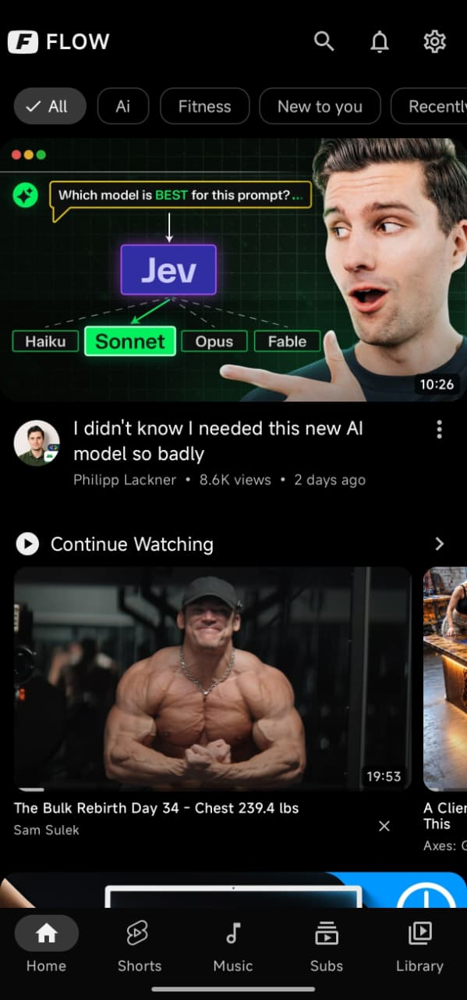
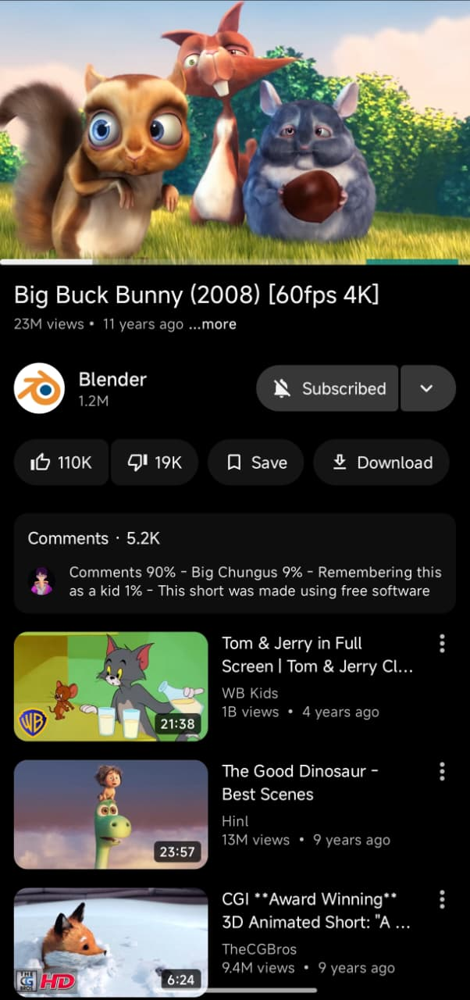
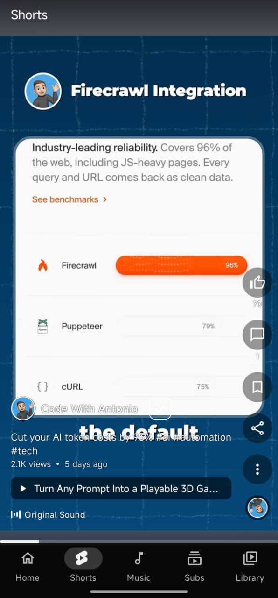
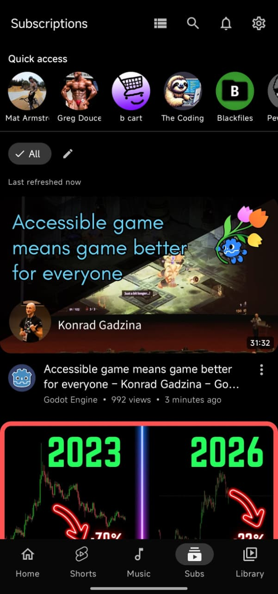
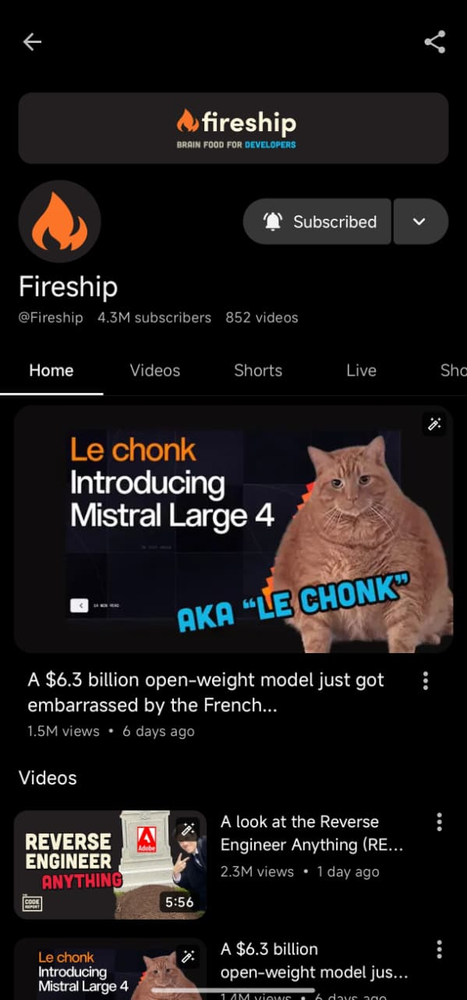
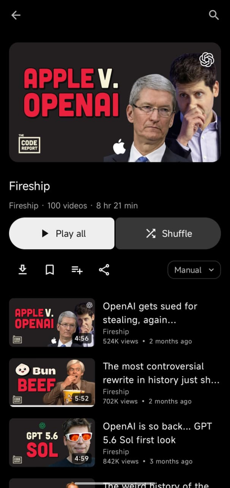
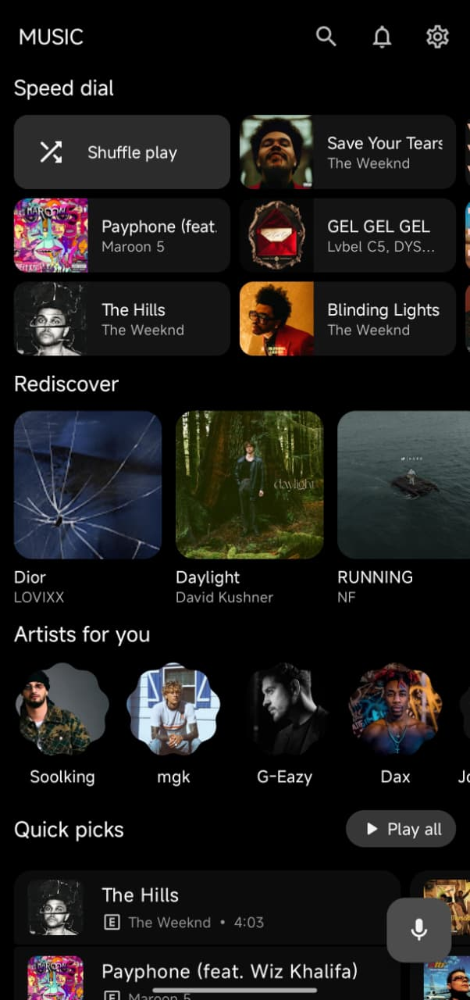
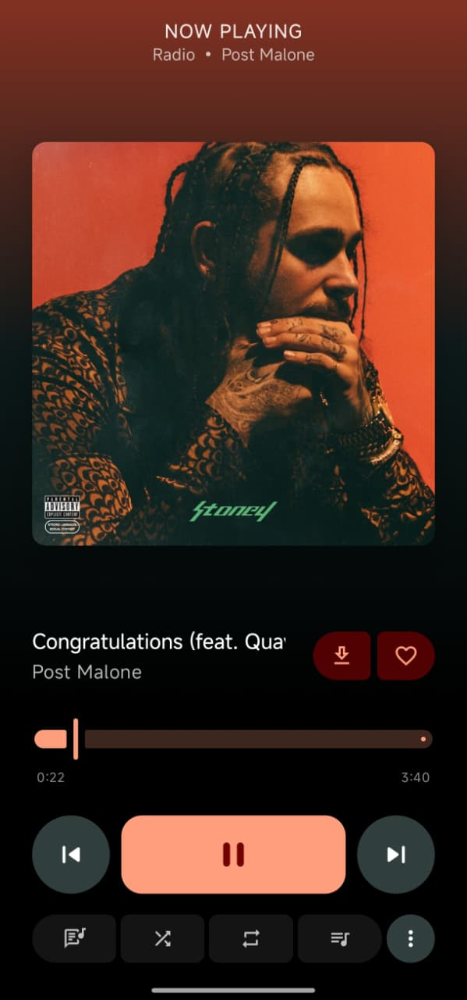
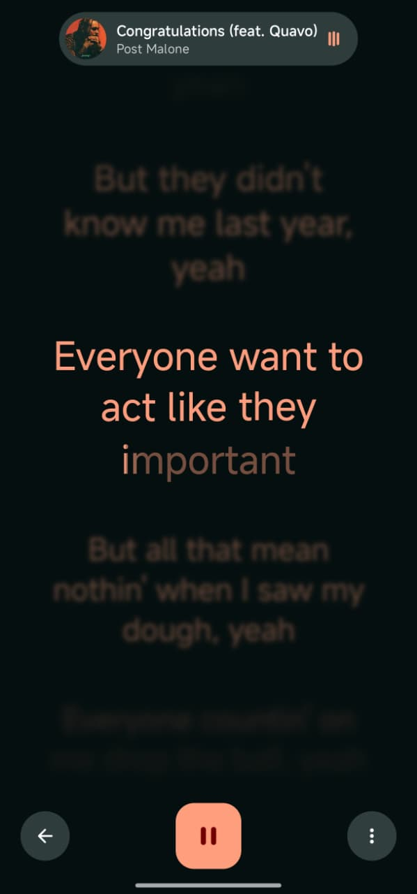

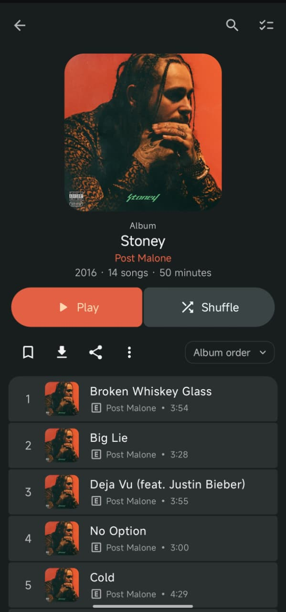
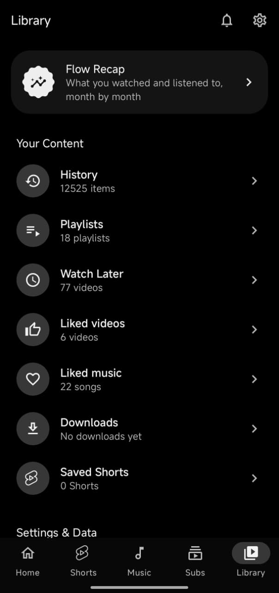
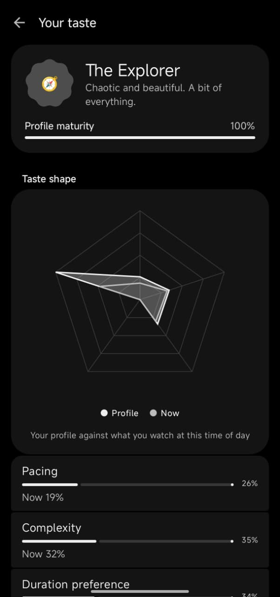

## Installation

VoidStream releases will be published here when available.

[VoidStream GitHub repository](https://github.com/aryannayak-real/Voidstream)

## Building from source

Requirements: Android SDK and JDK 21.

APK output:

## Donations

VoidStream donation options are being prepared. Please check back later.

## Credits and license

Derived from [Flow](https://github.com/Flow-Tube/Flow). Original copyright notices and applicable third-party attributions are retained. Licensed under GPL-3.0. See [License](License).
